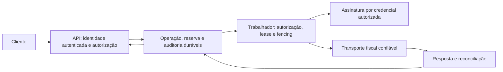

# EF-07 — contrato arquitetural para avaliação

Preparado em 18/10/2026 para a [issue #4](https://github.com/BrunoMNoronha/techlab-emissorfiscal/issues/4).
Bruno escolheu **PostgreSQL próprio em contêiner Docker**, gerenciável via Docker,
como referência da arquitetura nessa data.
Versão, hospedagem, responsáveis, topologia, acesso e política de recuperação
permanecem a definir; esta escolha não provisiona serviço nem inicia operação.
Este desenho especifica invariantes e alternativas para implementação posterior;
não comprova disponibilidade de empresa ou série, não cria infraestrutura, não
aprova custódia e não autoriza emissão. O piloto e os fatos indispensáveis da
[EF-06](PILOT-CONTRACT.md) continuam pendentes. O núcleo atual é offline e em memória.

## Fronteiras de confiança

1. O cliente fornece dados de venda e uma referência de idempotência. A API
   deriva a identidade autenticada de um mecanismo configurado pelo servidor;
   não confia em cliente, emitente, ambiente ou protocolo declarados no corpo
   como prova de acesso ou resultado fiscal.
2. Uma concessão efetiva vincula cliente, estabelecimento canônico, ação e
   ambiente. Operador central só administra as concessões dentro da delegação
   do emitente; isso não concede leitura automática de operações. Após verificar
   a concessão, consultas e artefatos também exigem propriedade do cliente.
3. A resolução de alias é feita no servidor para uma identidade fiscal canônica
   e um CNPJ de estabelecimento verificado. Antes de congelar o XML, comparar
   a identidade do emitente do XML e da chave com o estabelecimento da reserva.
   O pool atual recebe identidade opaca e `FreezeXml` só confronta série/número;
   a ligação com o CNPJ **ainda não é comprovada** no núcleo.
4. O trabalhador revalida autorização antes de ações protegidas e uso de A1.
   Revogação deve impedir novas ações; não presumir que interrompe I/O já em
   voo. A política para resposta tardia e acesso ao seu resultado precisa de
   decisão antes da integração. A origem de resposta fiscal deve ser o transporte
   controlado pelo serviço; XML apresentado por cliente não comprova autorização.

Políticas ASP.NET Core podem implementar avaliações de autorização, mas não
fornecem por si mesmas vínculos de domínio, proteção de artefatos ou revogação
transacional. Ver [políticas de autorização da Microsoft](https://learn.microsoft.com/en-us/aspnet/core/security/authorization/policies?view=aspnetcore-10.0).

## Modelo lógico e restrições

Nomes abaixo representam conceitos, não tabelas migradas.
IDs internos, CNPJ e chaves devem preservar a forma textual suportada; não
converter CNPJ alfanumérico, chave ou protocolo para número.

| Conceito | Vínculos e invariantes |
| --- | --- |
| Estabelecimento, alias e delegação | Alias aponta a uma única identidade canônica válida no contexto; troca/revogação é auditada. CNPJ de estabelecimento validado e sua associação exigem fonte confiável e histórico. |
| Cliente e concessão | Cliente autenticado; concessão por cliente, estabelecimento, ação e ambiente, com origem, validade e revogação. Acesso ao conteúdo exige também propriedade. |
| Pool e reserva | Um pool por estabelecimento canônico/modelo/ambiente/série. Restrição única para `(estabelecimento, modelo, ambiente, série, número)`; histórico de números não é apagado nem reinicializado por alias. O início do pool depende de série e próximo número aprovados. |
| Operação e referência | Unicidade da referência no escopo acordado de cliente, estabelecimento e ambiente; incluir versão do contrato e `requestHash`. Referência igual e conteúdo diferente gera conflito, sem consumir número. |
| Revisão e artefatos | Cada revisão mantém baseline, chave, XML assinado exato, SHA-256 dos bytes e digest fiscal. Revisão anterior e seus vínculos não são sobrescritos; correção continua indisponível no piloto inicial. |
| Tentativa, consulta e resposta | Tentativa registrada antes de I/O; XML enviado/revisão, retorno bruto, protocolo, alertas, origem e correlação preservados. Estado desconhecido não autoriza nem permite reenvio automático. |
| Eventos e auditoria | Histórico append-only com ator, ação, objeto, ambiente, resultado e correlação. Separar dados de auditoria de segredos e evitar XML ou conteúdo fiscal em logs operacionais. |

`requestHash` identifica o conteúdo de entrada segundo algoritmo/versionamento;
SHA-256 identifica os bytes persistidos; `digVal` é o digest fiscal assinado.
Eles possuem entradas e usos diferentes. O `rh1` atual é um núcleo offline, não
um contrato de replay durável com escopo de cliente implementado.

## Transações, falhas e recuperação

O desenho para PostgreSQL próprio deve implementar e testar as propriedades abaixo
com conexões independentes. A versão e a configuração permanecem pendentes:

1. Autenticar/autorizar e identificar o escopo antes da gravação. Uma transação
   resolve ou cria a referência idempotente sob restrição única; serializa o
   acesso ao pool; confirma a disponibilidade do número; grava operação, reserva
   e auditoria; e só então efetiva o commit. Em disputa pela mesma referência,
   o perdedor deve reler e comparar o hash antes de reservar. Uma falha ou
   rollback não deve produzir uma reserva parcialmente persistida.
2. A operação conserva número, identidade e baseline; gerar/validar/assinar e
   congelar os bytes é transição subsequente verificável. Verificar a concessão
   e o vínculo identidade/CNPJ também nesse ponto. A persistência e o resultado
   de uma transição devem falhar juntos, sem substituir revisão anterior.
3. Antes de iniciar transmissão, confirmar lease/fencing vigente, autorização,
   XML imutável e intenção de envio persistida. A transação de intenção termina
   antes do I/O. Se houver crash ou timeout depois dela, preservar a mesma
   operação e consultar/reconciliar; nem 217 isolado nem perda de lease
   comprovam ausência definitiva na SEFAZ.
4. Uma resposta pode chegar depois de expirar o lease. O trabalhador obsoleto
   não deve concluir a operação. Definir uma forma protegida de registrar ou
   encaminhar a evidência tardia para reconciliação, com origem e acesso
   verificáveis. Fencing controla a gravação local, não cancela a solicitação
   externa e não cria garantia de execução exatamente uma vez na SEFAZ.
5. Se os bytes estiverem fora do banco, uma gravação de objeto e uma transação
   de banco não são atômicas entre si. Definir estados intermediários,
   integridade por hash, recuperação de falhas entre etapas, isolamento,
   reconciliação e política de órfãos antes da escolha. Com bytes no banco,
   provar também tamanho, recuperação e desempenho; nenhuma alternativa foi
   aprovada apenas por esta descrição.

Para a referência PostgreSQL escolhida, a documentação descreve
[restrições de integridade](https://www.postgresql.org/docs/current/ddl-constraints.html),
[bloqueios de linha](https://www.postgresql.org/docs/current/explicit-locking.html#LOCKING-ROWS)
e [isolamento transacional](https://www.postgresql.org/docs/current/transaction-iso.html).
Esses mecanismos não demonstram a correção da aplicação: projeto de transação,
ordem de bloqueios, tratamento de erros e testes devem ser próprios. A opção
SQLite permanece referência comparativa, sem substituir os testes no PostgreSQL
escolhido.

## Referência operacional: PostgreSQL em Docker

O banco será operado em contêiner Docker próprio. Docker Compose é uma opção
para descrever o ambiente e seus serviços, ainda sem decisão de topologia ou
ferramenta de orquestração. A implantação concreta depende de versão, imagem,
host, recursos, responsáveis e controles ainda não definidos.

- Fixar uma versão suportada e uma imagem identificável; planejar atualizações e
  migrações entre versões principais com backup e restauração testados. Conferir
  `PGDATA` e o destino do volume na documentação da imagem escolhida: o layout
  varia entre versões. Não presumir que trocar a imagem atualiza os dados.
- Usar armazenamento persistente separado da camada gravável do contêiner,
  preferencialmente volume nomeado gerenciado pelo Docker. Verificar sua montagem,
  permissões, espaço disponível e persistência após recriação do contêiner.
  Volume não é backup e comandos que removem volumes exigem cuidado operacional.
- Restringir rede e credenciais ao mínimo necessário; não publicar o banco
  indiscriminadamente nem registrar senhas em Git, imagens ou logs. Definir
  mecanismo de entrega e rotação de segredos e contas distintas conforme funções.
- Definir verificação de saúde e reconexão da aplicação. Se Compose for adotado,
  a dependência por serviço saudável organiza a inicialização, mas não substitui
  tratamento de perda posterior de conexão ou provas de disponibilidade.
- Definir cópias independentes do host e do volume, com criptografia e acesso
  controlado, frequência, retenção e responsáveis. Considerar backup lógico e,
  conforme RPO/RTO, backup físico e arquivamento de WAL; `pg_dump` de um banco
  não inclui objetos globais como papéis. Validar também artefatos externos e
  segredos necessários, sem presumir que estejam no banco.
- Em ambiente de teste e com dados sintéticos, demonstrar reinício/recriação com
  dados preservados, falha e recuperação da conexão, backup e restauração em
  ambiente isolado, integridade e acesso restrito. Medir tempo e perda recuperável
  contra metas definidas antes do aceite; nenhum desses testes foi executado aqui.

Fontes: [volumes Docker](https://docs.docker.com/engine/storage/volumes/),
[ordem e saúde no Compose](https://docs.docker.com/compose/how-tos/startup-order/),
[imagem oficial PostgreSQL](https://github.com/docker-library/docs/blob/master/postgres/README.md),
[backup e restauração PostgreSQL](https://www.postgresql.org/docs/current/backup.html)
e [pg_dump](https://www.postgresql.org/docs/current/app-pgdump.html).

## Credenciais, auditoria e recuperação de dados

| Área | Requisito e decisão ainda necessária |
| --- | --- |
| A1 | Referenciar credencial por estabelecimento e ambiente; autorização e posse reais só após EF-13. Definir responsável, modo de custódia, acesso, expiração, revogação e rotação. Um cofre não implica que a chave seja não exportável ou possa assinar no formato requerido. |
| Segredos | Acesso mínimo por identidade de execução; separar ambientes, evitar PFX/senha/CSC em logs, repositório ou exemplos. Serviço, região e operação de recuperação continuam TBD. |
| Auditoria | Preservar concessão/revogação, tentativa, acesso, mudança e falha de segurança com correlação; definir acesso e integridade dos registros. A auditoria não deve transformar documentos fiscais ou segredos em logs comuns. |
| Retenção | Fonte jurídica, categoria de dados, responsável, destino e prazo continuam TBD; não inventar prazo nem apagar histórico por uma política de cache. |
| Backup e restauração | Definir RPO/RTO e política antes da operação; exercitar restauração isolada com dados sintéticos, verificar associação de identidade, XML, hashes, protocolo e histórico e provar retomada sem reenvio. Backup bem-sucedido não substitui teste de restauração. |
| Ambientes | Segregar credenciais, concessões, destinos e dados de homologação e produção. O núcleo atual somente admite ambiente 2; produção exige recorte, autoridade e validação próprios. |

## Matriz de prova para as próximas issues

| Issue | Prova sintética mínima antes do aceite operacional |
| --- | --- |
| EF-08 #5 | Clientes A/B, mesmo e diferente estabelecimento, aliases e ações diversas; negar acesso cruzado em consulta, artefatos e erros; revogação durante tarefa; XML de CNPJ diferente com série/número iguais não deve assumir o pool do estabelecimento. |
| EF-09 #6 | Reinício e restauração; bytes/hashes e vínculo de protocolo; tentativa de leitura cruzada; escrita de artefato interrompida antes/depois do commit; histórico não substituído. |
| EF-10 #7 | Duas conexões/processos com mesma referência/hash e com hash diferente; concorrência de número, rollback, pool não inicializado e CNPJ/alias; uma única reserva por operação e sem números duplicados. |
| EF-11 #8 | Isolamento de rota, resposta e download; cliente não injeta identidade ou protocolo confiável; contrato e variantes recusadas com tributação preservada. |
| EF-12 #9 | Dois trabalhadores, token obsoleto, crash antes/depois da intenção, timeout, resposta tardia, códigos 204/539/217 e consulta incompatível; nenhuma nova reserva ou reenvio automático. |
| EF-13 #10 | Com material sintético: escopo de acesso, expiração, rotação e revogação, logs sem segredo; titularidade, cadeia e credenciamento reais exigem prova própria. |
| EF-14 #11 | Transporte simulado com origem controlada, timeout e retorno truncado/divergente; confirmar ambiente e correlação; homologação só após credencial, emitente e autoridade definidos. |

## Decisões pendentes para concluir EF-07

- Versão do PostgreSQL, hospedagem, topologia, operação e ambiente; armazenamento de bytes; autenticação,
  execução de trabalhadores, custódia e provedor de segredos.
- Empresa, CNPJ/CRT, cliente e delegações; série e histórico; autoridade e
  aprovação tributária do caso de referência, conforme EF-06.
- Volume/pico, custos, responsáveis, região, SLA/RPO/RTO e fundamento da retenção.
- Política de revogação em trabalho já iniciado, preservação de resposta tardia,
  critérios de alerta e reconciliação e evidências de backup/restauração.

Além da escolha de PostgreSQL próprio em Docker, estes itens não foram decididos. Preencher com fonte, data,
autoridade e consequência; depois revisar componentes, custos e provas. A issue
permanece aberta enquanto escolhas e dependências indispensáveis não forem resolvidas.
